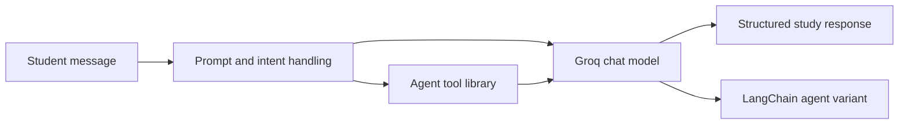

# Agentic AI Study Assistant

**A notebook prototype exploring LLM-powered study support and tool-using agents.**

## Overview

The Google Colab notebook demonstrates Groq chat model calls and a student-focused assistant workflow. Examples include structured task and assignment extraction, transforming notes into study material, academic-help intent handling, and a small tool library. A LangChain-based agent variant is also included.

## Key features

- Call Groq chat models using an API key.
- Extract tasks and assignment details from free-form text.
- Structure lecture notes into study notes and respond to study-support requests.
- Demonstrate guarded handling of requests to complete academic work.
- Experiment with tool functions and a LangChain agent workflow.

## Tech stack

Python, Jupyter Notebook, Groq API, python-dotenv, LangChain, langchain-groq, langchain-community, and Requests.

## Architecture and workflow



## Project structure

```text
.
└── Agentic_AI_SDP.ipynb
```

## Installation and execution

The notebook includes package-install cells and is designed to run in Google Colab. Set a `GROQ_API_KEY` in Colab Secrets (or provide it through a local `.env` file when running in a compatible Jupyter environment), then open and run the notebook cells in order.

For a local environment, install the notebook dependencies first:

```bash
python -m venv .venv
# Activate the environment for your shell, then:
python -m pip install jupyter groq python-dotenv langchain langchain-groq langchain-community requests
jupyter notebook
```

Groq API access and a valid API key are required for model-backed cells. Some examples also use network-backed tools.

## Screenshots and demo

No screenshots or hosted demo are included; examples and outputs are in the notebook.

## Author

**Gireesh Sadanand Patgar** · [GitHub](https://github.com/gireeshpatgar17)
